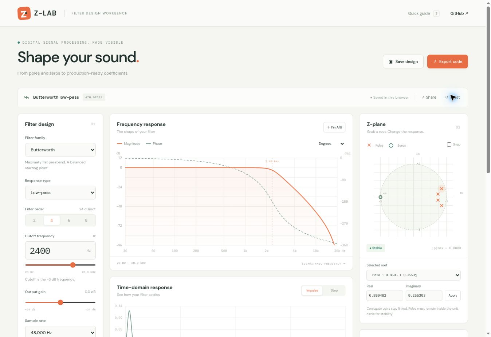

# Z-Lab — Filter Coefficient & Z-Plane Visualizer

A browser-based DSP workbench for designing IIR/FIR audio filters, editing poles and zeros, analyzing responses, and exporting C/C++ processing code.

**[Open the workbench](https://djshellshoxxx.github.io/Filter-Coefficient-Z-Plane-Visualizer/)** · **[Implementation specification](docs/SPEC.md)**



## Features

- Butterworth, Chebyshev I/II, elliptic, bilinear state-variable, and Hamming-windowed FIR designs.
- Conjugate-aware root dragging, numerical and keyboard editing, grid snapping, and strict stability checks.
- Log-frequency magnitude and unwrapped phase; 512-sample impulse and step response.
- Direct Form I, Direct Form II, and Transposed Direct Form II biquad cascades.
- Complete C/C++ DSP kernels, plus JUCE and VST3 integration adapters.
- Four extras: audio audition with bypass, saved/portable designs, A/B magnitude comparison, and coefficient quantization analysis.

All DSP computation and storage are local to the browser. The application needs no package installation and has no runtime JavaScript dependencies.

## Develop and verify

Use Node.js 22 or later. GCC and G++ are required for compiled export tests.

```sh
npm test
npm run build
python3 -m http.server 8080 --directory dist
```

Open http://localhost:8080. The static source can also be served directly from the repository root. Do not open `index.html` as a `file://` URL because browsers restrict ES module loading.

Tests include 114 independent SciPy reference designs, numerical properties, compiled C99/C++17 impulse checks, and SDK adapter interface checks. Fixtures are checked in; regenerating them requires Python, NumPy, and SciPy:

```sh
python3 tests/generate-fixtures.py
```

## GitHub Pages

The workflow validates the math and exports, builds `dist/`, uploads the Pages artifact, and deploys pushes to `main`. Pull requests run checks without deployment. In repository **Settings → Pages → Build and deployment**, select **GitHub Actions** as the source, then run **Validate and deploy GitHub Pages** if needed. All asset URLs are relative, so the repository subpath works without configuration.

## Export contracts

Initialize/reset separate filter state for each audio channel. Use the design sample rate. Float64 exports use double arithmetic; Float32 and Q2.14 exports use float arithmetic (Q2.14 models coefficient quantization only). JUCE/VST3 adapters require their respective SDKs. VST3 output is a processing base for integration into a plugin project, not a complete registered plugin. SDK interface tests use stubs; full SDK compilation remains an integration responsibility.

The help panel and [specification](docs/SPEC.md) document cutoff conventions, numerical behavior, supported ranges, and limitations. Adapted SciPy prototype algorithms retain their license in [third-party notices](THIRD_PARTY_NOTICES.md).
